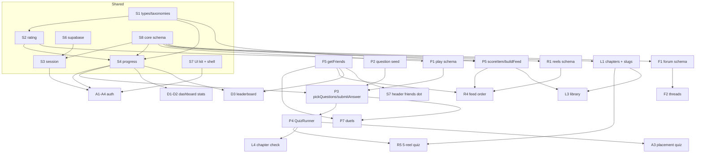

# IMPLEMENTATION.md — build plan for parallel agents

How to build lifeIsGood with as many subagents running at once as possible without them drifting apart. Read this with `docs/TEAM.md` (ownership), the feature `README.md`s (scope) and `src/features/play/docs/*.md` (quiz flow and coins, scoring, rating, questions, recommendation). `QUIZ.md` is the single source of truth for everything about coins.

Status on 2026-10-11: Waves 0, 1 and 2 are implemented. Wave 2 was verified on 2026-10-11 (§3, "Wave 2 verification"): `npm run build`, `tsc`, full lint and 48 tests pass; the review found one critical and several high-severity bugs, listed as Wave 3a fixes. A second review the same day confirmed every listed row and added W3-S7–S8, W3-P8–P12, W3-L3 and W3-F4. Live Supabase and browser checks are still pending. Wave 3a is implemented and integrity-checked (§3, "Wave 3a integrity check").

---

## 0. Decisions (settled 2026-10-10)

`UI.md` and `deliverables/M1.pdf` were written before the Play docs and disagreed with them. These are the resolutions, and every .md file has been updated to match. `M1.pdf` is a submitted snapshot and isn't edited; where it differs, the .md files win. Which doc owns which topic is in `docs/TEAM.md`.

| # | Topic | Resolution | Spec |
| --- | --- | --- | --- |
| D1 | Routes | `/dashboard`, `/play`, `/play/duel`, `/play/quiz`, `/play/quiz/review`, `/reels`, `/learn`, `/learn/<slug>`, `/forum`, `/forum/friends`. Bottom nav order: Home · Play · Reels · Forum · Learn (`nav.ts` order changes in S7) | UI.md §1.2 |
| D2 | Coins | In scope for the project; SCORE.md just doesn't award them. +3 per correct first try (practice, reel, chapter), 1-coin reattempt wager refunded if right, +10 daily login. Nothing else gives coins; they buy only reattempts. None in duels or placement | QUIZ.md §6 |
| D3 | Rating | Two numbers. **Level** (XP, never drops, gives the title). **Skill rating** (Elo, starts 800, floor 100, can drop) drives question difficulty, the XP multiplier, duel XP upsets and matchmaking. Shown only to the student; the quiz end screen shows the change in green/red | RATING.md §1, §10; SCORE.md §8 |
| D4 | Leaderboard | Friends and Global tabs, ranked by last-7-day XP. Rows: rank, username, title. No numbers, schools or coins | RATING.md §7 |
| D5 | Auth | Sign up with email, username and password plus one verification link; sign in with email and password. Verification may be off in the demo project | auth README |
| D6 | Locked chapters | Never locked. The galaxy shows "Recommended for you"; bubble radius = `scoreItem` | RECOMMENDATION.md §5 |
| D7 | Reel quiz | After every 5 reels (skips don't count), a 3-question quiz on those reels; scrolling locked until done, and it returns if the student leaves. Replaces the per-reel check. The 30-reel stop card stays | QUESTIONS.md §6, RECOMMENDATION.md §4 |
| D8 | Owners | TEAM.md | |
| D9 | Name | lifeIsGood (M1 says FinQuest) | |
| D10 | Node | Node 22+. Local machine has 18.19; upgrade before Wave 0 (Next 16 and `node --test` with type stripping need it) | README |
| D11 | Duels | Fastest finger, 30 s rounds: the first correct answer to reach the server takes the round (100 + speed bonus); a wrong answer freezes you for the round. Server decides order | SCORE.md §4 |
| D12 | Quiz timeout | Counts as wrong; the reattempt is still offered | QUIZ.md §3 |
| D13 | Personal data | Email, username, language, grade only. No school, city or real name. Others see username + title | TEAM.md |
| D14 | Integrity | Only server code writes XP, coins and rating; students read only their own ledger rows | §6 |

Keep from UI.md: the shell (top header + 5-tab bottom nav), dark theme palette, page layouts, the duel freeze and speed-combo visuals, the coins pill and wager popup, the quiz review highlighting rules, the friends heart dot.

---

## 1. Module map

### 1.1 Shared modules (platform, Praveen — `src/shared/`, root, `*_core_*.sql`)

Everything another module imports. These are built first and their **signatures frozen**; bodies can be stubs.

| ID | Module | Path | Exports | Status |
| --- | --- | --- | --- | --- |
| S1 | Types & taxonomies | `src/shared/types.ts` | `Language`, `Pillar` (exist); add `Tier`, `TIERS`, `TAGS` (QUESTIONS.md §3, keyed by pillar), `Tag`, `QuestionContext` (`practice`/`duel`/`reel`/`chapter`/`placement`), `"auth"` added to `FeatureName` (for `daily_login`), `ContentItem` and `RecUser` (RECOMMENDATION.md §1, §8), `PublicProfile` (`id`, `username`, `title`, `level?` — level only for friends, RATING.md §7) | partial |
| S2 | Rating math | `src/shared/rating.ts` | `getLevel(totalXp)`, `getTitle(level)`, `getTier(level)`, `getSkillTier(rating)`, `tierDiff(a, b)`, `expectedScore(rating, opponent)`, `TIER_RATING`, `START_RATING` — pure, no imports (RATING.md §9–10) | new |
| S3 | Session | `src/shared/session.ts` | `getCurrentProfile()` — real Supabase lookup, falls back to `DEMO_PROFILE` when env is missing | implemented locally; live verification pending |
| S4 | Progress | `src/shared/progress/` | `recordActivity(event)` — server-only, event gains `coins?`, `ratingDelta?` and a required `ref` (§6); user comes from the session, never a parameter; calls `core_record_activity()` with the admin client. Add `getXpSummary(userId)` → `{ totalXp, level, progress, title, rating, streakDays, pillarXp, weeklyXp, coins }` and `getLeaderboard(scope: "friends" | "global", friendIds?)` → rows of `{ rank, username, title, isCurrentUser }` plus the student's own rank. Streak = consecutive IST days with ≥ 1 event (the daily-login event counts). None of these is a server action | implemented locally; live verification pending |
| S10 | Public profiles | `src/shared/profiles.ts` | `getPublicProfiles(ids, { includeLevel })`, `searchPublicProfiles(query)` → `PublicProfile[]`; server-only, level only for friends (RATING.md §7). Added in the Wave 1 review | done |
| S5 | i18n | `src/shared/i18n/` | `useT`, `useLanguage`, `LanguageProvider` — provider must take `initialLanguage` from the profile | partial |
| S6 | Supabase clients | `src/shared/supabase/` | `createClient()` ×2; add `admin.ts` (service-role client, `import "server-only"`, used only by S4) | partial |
| S7 | UI kit & shell | `src/shared/ui/`, `src/app/(app)/layout.tsx`, `globals.css` | `Header` (title badge, streak, coins, friends dot), `BottomNav` (5 tabs, icons, order per D1), `Button`, `Card`, `ProgressBar`, `TitleBadge`, `Toast`, `Celebration`. Dark tokens from UI.md as CSS variables. The `(app)` layout records the daily-login bonus on the server (QUIZ.md §6) | partial |
| S8 | Core schema | `supabase/migrations/*_core_*.sql` | New migration (never edit `20261010000000_core.sql`): `profiles` + `onboarded_at`, `persona` (jsonb: onboarding answers → initial pillar need); `xp_events` lockdown per §6 (`coins`, `rating_delta`, `ref`, no client inserts, own-rows-only reads, `core_record_activity()`) | implemented locally; live verification pending |
| S9 | Env & tooling | root | `.env.example` (incl. `SUPABASE_SERVICE_ROLE_KEY`, never `NEXT_PUBLIC_`), `npm install`, `CODEOWNERS`, Vercel project, `npm run test` = `node --test` over `src/**/*.test.ts` | missing |

### 1.2 Independent modules (one owner each)

Each row is a unit one subagent can build alone once Wave 0 is merged. "Needs" lists only frozen contracts, never another module's implementation.

**Auth — Praveen** (`src/features/auth`, `src/app/(auth)`)

| ID | Module | Needs |
| --- | --- | --- |
| A1 | Sign-up (email, username, password, verification link) / sign-in / sign-out form (D5), route protection for `(app)` (Next 16 middleware/proxy — read the docs first) | S3, S6, S7 |
| A2 | Onboarding: language, grade, 3–4 persona questions → `profiles.persona` (username is set at sign-up, D5) | S1, S8 |
| A3 | Optional placement quiz (RATING.md §4) — links to `quizHref({ context: "placement" })`. **Resolved:** allow only `/play/quiz?context=placement` before onboarding completes. Save onboarding answers without setting the date; resume unanswered questions in the same attempt after interruption. Return to onboarding to finish, or explicitly skip, then set `onboarded_at` | P3 contract |
| A4 | Profile page: edit language/grade, drives `LanguageProvider` | S5 |

**Play — Sanjith** (`src/features/play`, `src/app/(app)/play`)

| ID | Module | Needs |
| --- | --- | --- |
| P1 | Schema: `play_questions`, `play_answers` (QUESTIONS.md §2) | S8 |
| P2 | Question bank seed: ~160 questions, 4 pillars × 5 tiers, en first (QUESTIONS.md §8) as JSON + seed SQL | S1 `TAGS` |
| P3 | Quiz engine: `pickQuestions()` (§4–6), `submitAnswer()` (SCORE.md §3 and §8, daily cap, repeats; coins and reattempt wager per QUIZ.md), `revealAnswer()` ("Show answer": returns the answer and forfeits the reattempt) — server actions; plus server-only `getAttemptResult(attemptId)` for Learn. Integrity rules in §6 | P1, S2, S4 |
| P4 | `QuizRunner` + review screen (QUIZ.md flow, UI.md pages 8–9 layout), mounted only by `/play/quiz`. Play practice, Learn, Reels and Auth open it with `quizHref()` | S7, P3 contract |
| P5 | Recommendation pure functions: `scoreItem(item, user, candidates)`, `buildFeed(candidates, user)` (RECOMMENDATION.md §3–4) + tests | S1, S2 |
| P6 | Solo simulations (≥ 1: "survive the month"), each with stated assumptions, `sim_completed` XP | S4, S7 |
| P7 | Duels: `play_duels`, `play_queue`, `play_find_match()` (by rating), fastest-finger rounds decided in Postgres, Realtime `play:lobby` presence + per-duel broadcast (display only), server-rolled bot, result screen, block/report | P1, P3, F5 contract |
| P8 | Play hub page (`/play`): practice quiz, sims, duel entry | P4, P6, P7 |

**Reels — Sai Abhinav** (`src/features/reels`, `contents/reels`)

| ID | Module | Needs |
| --- | --- | --- |
| R1 | Clips are served from `public/media/reels/` (HTTP range support for mobile video; placeholders from `contents/reels/make-placeholders.sh`). Schema + manifest: `reels_items` (id, file, captions, pillar, tags, level, language, `created_at`), `reels_events` (view/complete/skip/like/save/share) + placeholder clips | S1, S8 |
| R2 | Feed player: scroll-snap, autoplay visible, preload next, mute, double-tap like, hold-to-pause, 5-reel quiz lock, 30-reel stop card | S7 |
| R3 | Engagement logging + `reel_watched` XP | R1, S4 |
| R4 | Feed ordering: load candidates + engagement, call `buildFeed` | R1, P5 contract, F5 contract |
| R5 | 5-reel quiz (link to `quizHref({ context: "reel", reelIds, returnTo: "/reels" })`), server-side count of reels since the last quiz, and "Learn more" → `/learn/<slug>`. Done in Wave 2: the gate resets only on a *finished* reel attempt (Play's `getLastFinishedAt`, D7); `quiz_opened` was removed | P3/P4 contracts, L1 slugs |

**Learn — Saikiran** (`src/features/learn`, `contents/pdfs`)

| ID | Module | Needs |
| --- | --- | --- |
| L1 | Manifest `src/features/learn/data/chapters.json` (slug, pillar, tags, level, `requires`, `createdAt`; titles in `messages/*.json`; no `learn_chapters` table), `learn_progress` (opened, last page, finished) + placeholder PDFs rendered to page images by `contents/pdfs/render.sh`. **Publish the slug list early** — Reels and Forum link to it | S1, S8 |
| L2 | Reader `/learn/[slug]`: page-by-page render, swipe, remember last page, progress bar (UI.md page 5 modal). Prefer pre-rendered page images over a PDF.js bundle on low-end phones — decide in L2 | S7, L1 |
| L3 | Library `/learn`: Continue reading, Recommended (galaxy bubbles sized by `scoreItem`), All chapters by pillar, "Read X first" hints | L1, P5 contract |
| L4 | End-of-chapter check: link to `quizHref({ context: "chapter", chapterSlug })`; `chapter_finished` XP only after `getAttemptResult()` confirms ≥ 60% (§6) | P3/P4 contracts |

**Forum + friends — Sashwat** (`src/features/forum`)

| ID | Module | Needs |
| --- | --- | --- |
| F1 | Schema: `forum_threads`, `forum_replies`, `forum_votes`, `forum_reports` | S8 |
| F2 | Thread list + filter by pillar + search, thread detail, reply, upvote | F1, S7 |
| F3 | Safety: report button, hide-on-N-reports, block phone numbers/emails in posts (regex at insert, DB check constraint) | F1 |
| F4 | XP: `post_created`, `answer_accepted` | S4 |
| F5 | Friends: `forum_friends` (requests + accepted), `/forum/friends` page (search by username, accept/decline), **`getFriends(userId)` → `PublicProfile[]`**, `getPendingRequestCount(userId)` for the header dot | S1, S8 |

**Dashboard — Sashwat** (`src/features/dashboard`)

| ID | Module | Needs |
| --- | --- | --- |
| D1 | Profile card: title, level, progress bar, skill rating, coins, streak | S4 `getXpSummary` |
| D2 | Per-pillar bars (relative to strongest pillar) | S4 |
| D3 | Leaderboard, Friends and Global tabs (7-day XP) — `getLeaderboard()` (S4), with `getFriends()` ids for the Friends tab; `xp_events` is not readable across users. No Play export needed | F5 contract, S4 |
| D4 | Continue shortcuts (last reel / chapter in progress / play) | L1, R1 contracts (URLs only) |

### 1.3 Content modules (no code — ideal for wide agent fan-out)

| ID | Content | Owner | Format |
| --- | --- | --- | --- |
| C1 | Question bank, en (P2) — one agent per pillar | Play | `src/features/play/data/questions/<pillar>.json` |
| C2 | Chapter manifest + placeholder chapters | Learn | `src/features/learn/data/chapters.json` |
| C3 | Reel manifest + placeholder clips | Reels | `src/features/reels/data/reels.json` |
| C4 | `te` / `hi` translations of every `messages/*.json` and question bank | each owner | same files; native-speaker check before `live` |
| C5 | Demo seed: 6–8 fake students with XP history and friendships | Platform | `supabase/seed.sql` |

---

## 2. Dependencies



**Critical path:** S1/S2/S4 → P1 → P3 → P4 → (R5, L4, A3). The `/play/quiz` screen and `pickQuestions/submitAnswer` are what most features depend on; Play should build P1→P3→P4 before sims and duels.

**Second bottleneck:** `getFriends` (F5) is used by Play duels, Reels/Learn recommendation, Dashboard leaderboard and the header dot. Sashwat builds F5 before F2.

**Cross-feature rules that remove hard dependencies:**
- Cross-feature references are plain text columns, never foreign keys (`play_questions.reel_id`, `chapter_slug`). Migrations then never depend on another feature's migration order.
- Cross-feature imports come from the other feature's `index.tsx` or `server.ts` only (TEAM.md rule 4). `index.tsx` must stay safe to import from client code: pure functions, types, and server actions re-exported from the feature's `"use server"` file (`actions.ts`). Server-only helpers that other features call from their server code (`getFriends`, `getPendingRequestCount`, `getAttemptResult`) live in `server.ts` — not a `"use server"` file, and never re-exported from `index.tsx` (§6). Each `server.ts` starts with `import "server-only"`, so importing it from client code fails the build.
- Links between features are URLs (`/learn/<slug>`, `/play/quiz?pillar=save`), never imports.

---

## 3. Order of implementation

Four waves. Inside a wave every row is a separate subagent; nothing in a wave waits on anything else in the same wave.

### Wave 0 — contracts (serial, ~1–2 h, blocks everyone)

One platform agent, then one tiny commit per feature owner. Merge to `main` before Wave 1 starts.

1. **Platform agent:** D10 (Node 22) and `npm install` are done by a human (AGENTS.md); the agent writes `.env.example`, `.gitignore`, S1 additions, S2 with tests, S4 signatures for the new `recordActivity` event shape, `getXpSummary` and `getLeaderboard` (bodies may return zeros), S5 `initialLanguage`, S7 shell (`Header` + new `BottomNav` + tokens + 5–6 primitives), `npm run test` script. Read `node_modules/next/dist/docs/` first (AGENTS.md).
2. **Contract stubs, one per owner, each a few lines in their own feature folder (`index.tsx`, `actions.ts`, `server.ts`, `data/`)** (so nobody edits another's folder):
   - Play: `pickQuestions`, `submitAnswer` (`actions.ts`), `getAttemptResult` (`server.ts`), `scoreItem`, `buildFeed`, `quizHref`, and a stub `/play/quiz` route with `QuizRunner` — typed signatures returning fixtures (3 hard-coded questions; `buildFeed` returns input unchanged).
   - Forum: `getFriends` → `[]`, `getPendingRequestCount` → `0`.
   - Learn: commit `data/chapters.json` with the agreed slugs (even if PDFs are placeholders).
   - Reels: commit `data/reels.json` with placeholder ids.

After Wave 0, every Needs column above is satisfied by a stub.

### Wave 1 — independent builds (fully parallel, ~19 agents)

Praveen platform status (2026-10-11): A1, A2, S3/S4 and S8 are implemented locally. Targeted lint and pure validation/date/rating tests pass; database migration, live auth/integrity checks and the Next build remain pending. Setup and validation details are in `src/features/auth/README.md`. A3/A4 remain Wave 2.

| Owner | Agents (one each) |
| --- | --- |
| Platform | A1 auth + route protection · A2 onboarding · S3+S4 real implementations · S8 core migration |
| Play | P1+P3 quiz engine (one agent: schema and engine are tightly coupled) · P4 QuizRunner/review UI (against the stub) · P5 recommendation + tests · P6 simulation · C1 ×4 (one per pillar) |
| Reels | R1 schema + manifest · R2 feed player · R3 engagement logging |
| Learn | L1 schema + manifest · L2 reader · L3 library UI (against `scoreItem` stub) |
| Forum | F5 friends + `getFriends` (first) · F1+F2 threads · F3 safety |
| Dashboard | D1+D2 stats |

### Wave 2 — integration (parallel, after the Wave 1 PRs it names are merged)

Praveen integration status: A3, A4, D3 and D4 implemented locally with user-approved scope. `/profile` is linked from the dashboard. Continue links use Learn progress and Reels’ server-only `getContinueReelHref()`. TypeScript, targeted lint and 39 tests pass; mocked server integration checks pass. Live Supabase/browser verification and a Next build are still pending. No migrations or packages added.

| Agent | Waits for |
| --- | --- |
| P7 duels (lobby, queue, bot, result) | P3, F5 |
| P8 play hub | P4, P6 |
| R4 feed ordering | R1, P5, F5 |
| R5 5-reel quiz + Learn-more link | P3, P4, L1 |
| L4 chapter check | P3, P4 |
| L3 swap stub for real `scoreItem` | P5 |
| A3 placement quiz, A4 profile | P4 / S5 |
| D3 leaderboard, D4 shortcuts | F5 / R1, L1 |
| Header friends dot | F5 |
| F4 forum XP | S4 real |

### Wave 2 verification (2026-10-11)

All Wave 2 rows above are implemented: P7 (bot, quick match, friend invites; phones poll `/play/duel/<id>/state` instead of Realtime), P8, R4, R5, L3, L4, A3, A4, D3, D4, the header friends dot and F4. `npm run build`, `tsc --noEmit`, `eslint` and `npm run test` (48) pass. Not yet done: applying the migrations to the Supabase project, and browser/two-phone testing. Review findings that need fixing are the Wave 3a "Fix" rows below; smaller ones are listed per owner.

Second review (2026-10-11): all migrations applied in order to an in-memory Postgres and 70 checks ran as the `anon`, `authenticated` and `service_role` roles. Three failed, all already listed: W3-S1 (a thread author rewrote another student's reply), W3-S2 and W3-F1 (a downvote insert succeeded). Duel tables, `play_find_match`, the one-correct-answer-per-round index and the reel-gate constraint passed. A code trace of every Wave 2 flow confirmed each Wave 3a row below and added the rows marked *(review 2)*. `tsc` needs `npx next typegen` (or a build) first, or the `/play/duel/[id]` route types are missing.

Build note: with no Supabase env vars, `/play`, `/dashboard`, `/learn`, `/forum` and `/onboarding` prerender as static pages with the demo profile. Vercel must have the Supabase variables at **build** time, or every student sees the demo student.

### Wave 3a — required for the demo (parallel per owner)

Rows marked **Decide** need the named owner(s) to agree a rule before coding. Translations (C4) are drafted by Claude agents and checked by a Telugu and a Hindi speaker on the team before merging; translated questions stay `draft` until checked (QUESTIONS.md §8).

**Platform — Praveen**

| ID | Task |
| --- | --- |
| W3-S1 | **Fix (critical):** drop the `"thread authors accept replies"` UPDATE policy on `forum_replies` (new `*_core_*` or `*_forum_*` migration, agree with Sashwat). With the `update (content)` grant it lets a thread author rewrite other students' replies; accepting already goes through the definer RPC |
| W3-S2 | **Fix:** duplicate migration version `20261011140000` (`core_public_profiles` and `forum_accept_reply`); rename the forum one to an unused timestamp before anything is applied |
| W3-S3 | Create the Supabase project's schema: apply every migration in order, set env vars on Vercel (build and runtime), deploy |
| W3-S4 | **Decide + fix:** awarding XP to someone other than the signed-in student. Forum calls `core_record_activity` directly (bypassing `recordActivity`, and its RPC errors are ignored); duels need it to settle both players at once (Play row W3-P1). Proposal: a server-only `recordActivityFor(userId, event)` in `src/shared/progress` |
| W3-S5 | **Fix:** `src/proxy.ts` now queries `profiles` on every protected request (including the 1 s duel poll) and turns any lookup error into a 500 on every page. Skip the lookup for `/play/duel/*/state`, and degrade instead of throwing |
| W3-S6 | Shared changes queued by features: hide the bottom nav on `/play/duel/<id>` (UI.md page 6 currently shows it), `captionLanguages` on `ContentItem`, `persona` on `RecUser`, daily caps checked inside `core_record_activity` (W3-F2) |
| W3-S7 | **Fix** *(review 2)*: a missing `SUPABASE_SERVICE_ROLE_KEY`, or any error from `core_xp_summary`, makes every `(app)` page a 500: `getXpSummary` in `(app)/layout.tsx` isn't caught (only the daily login is). Degrade the header instead |
| W3-S8 | **Decide** *(review 2)*: onboarding is checked only by pages. Server actions (`createThreadAction`, `pickQuestions` for practice, duel actions) don't check `onboardedAt`, so an un-onboarded student can call them. Integrity is unaffected; agree whether actions must check it |
| C5 | Demo seed (`supabase/seed.sql`, 6–8 fake students with XP history and friendships) and a scripted demo path: sign up → onboarding (+ placement) → 5 reels → reel quiz → chapter → chapter check → duel vs bot → dashboard |
| C4 | te/hi for `auth`, `src/shared/ui` messages |
| Review | 360px screenshots of auth, onboarding, profile, header and nav; `npm run build` after every merge |

Platform Wave 3a local progress: W3-S1 has a new policy-removal migration;
W3-S2 renames the duplicate Forum migration to `20261011140001` without changing
its SQL. W3-S5 skips the profile lookup for duel polling and degrades proxy lookup
errors. W3-S7 degrades the header on summary/service-role failures without
inventing zero balances. W3-S6 hides active-duel navigation and adds optional
`ContentItem.captionLanguages` and `RecUser.persona` fields. C5 adds eight
synthetic fixtures and `docs/DEMO.md`; C4 auth/shared te/hi drafts are ready for
native-speaker review. TypeScript, targeted lint and 55 tests pass. The SQL
regression and seed have not run against Supabase. W3-S4, W3-S8 and the Forum
reply-award rule await Praveen's decisions; their changes have not been made.
W3-S3 awaits project access/configuration; build, deployment and 360px browser
review remain pending. Header's three progress props are now optional; this is
backward-compatible with existing feature callers. Shared field additions affect
Play/Reels/Learn (Sanjith/Sai Abhinav/Saikiran), and the reply policy/migration
repair affects Forum (Sashwat).

**Play — Sanjith**

| ID | Task |
| --- | --- |
| W3-P1 | **Decide + fix:** a losing duel player can avoid the rating loss by closing the app (only their own phone claims; a forfeit is never claimed). Settle both players on the server when the duel ends (needs W3-S4) |
| W3-P2 | **Fix:** bot duels can be cancelled for free (the bot's answers never count as "round 1 answered"); idle bot duels never finish |
| W3-P3 | **Fix:** quick-match queue rows can lock forever if the duel insert fails after `play_find_match`; stale rows reuse an old `duel_id` or `joined_at`; a player can be queued and in a duel at once. Clear the queue in `leaveOtherDuels`, expire matched rows, reset `joined_at` |
| W3-P4 | **Fix:** `patchDuel` updates the in-memory row even when the conditional update lost (challenger sees "expired" while the duel is live); `answered_at` should be the database's `now()`; round 1 starts before the matched player has loaded |
| W3-P5 | **Fix:** an empty reel-quiz attempt counts as "finished" and clears the Reels gate (`getLastFinishedAt`, reject 0-question reel attempts); "prefer completed reels" in reel quizzes (QUESTIONS.md §6) |
| W3-P6 | **Decide:** chapter-bonus retakes (a failed check can be reviewed and retaken on the same 5 questions) and claiming mid-quiz via ✕; placement resume gives a seen-but-unanswered question a fresh timer. Agree with Saikiran / Praveen |
| W3-P7 | UI fixes: duel claim and answer network errors (retry, don't lock the round), invitee opening the invite link, hub/quick-match error states and double taps, "+0 coins" and "x / remaining" on the placement end screen |
| W3-P8 | **Fix** *(review 2)*: invites can't be cancelled. "Back to Play" on the waiting screen leaves the invite open; if the friend accepts later, the absent challenger is forfeited after 15 s and the friend gets a full win. Add a cancel (and cancel on leaving the waiting screen). Same free win when a quick-match player closes the tab while their queue row is still fresh (`seen_at` < 6 s) |
| W3-P9 | **Fix** *(review 2)*: `forfeit()` (`duelStore.ts`) cancels whenever no human answered round 1, even in round 4, so a losing player whose round 1 timed out can leave for free. Cancel only while round 1 is still running. `leaveOtherDuels` also forfeits duels that already finished by time (a win becomes a loss); settle those as `done` |
| W3-P10 | **Fix** *(review 2)*: reel-quiz top-up takes tags from the linked questions, not the reels (QUESTIONS.md §6), so 5 reels with no linked questions give an empty quiz. Do with W3-P5 and W3-R3: if W3-P5 alone rejects empty attempts, the gate gets stuck for good. Also: any finished reel attempt clears the gate, not only the one for the 5 gated reels (attempts don't store reel ids) — decide with Sai Abhinav whether that matters |
| W3-P11 | **Fix** *(review 2)*: when `submitAnswer` fails, `QuizRunner` still lets the student go on and shows "Quiz completed", but the attempt stays unfinished (reel gate returns; chapter question counts as wrong). Retry the submit, or say the quiz didn't count |
| W3-P12 | Smaller *(review 2)*: duel XP isn't in the daily soft cap (SCORE.md §3); cross-language quick match from 10 s ignores "5 questions in both languages" (RECOMMENDATION.md §6) and serves English-only; an expired session makes the arena's poll get the login page, freeze silently and forfeit; `play_reports` has no unique key, so one student can report an opponent repeatedly; unknown `chapterSlug` creates empty attempts |
| C4 | te/hi drafts for the question bank (one agent per pillar, stay `draft` until checked) and Play's `messages/` |
| Review | 360px screenshots, two-phone duel test, "educate never recommend" pass over the bank |

**Reels — Sai Abhinav**

| ID | Task |
| --- | --- |
| W3-R1 | **Fix:** the waiting quiz gate disappears when the ranked feed is empty (`ReelsFeed.tsx`: check the gate before "nothing here") |
| W3-R2 | **Fix:** drop session-seen reels *before* `buildFeed` (RECOMMENDATION.md §8), not after; likes/saves counted per toggle in tag interest; 30-day window for likes and saves in `reels_item_stats`; limit/order the 30-day history query |
| W3-R3 | Real clips for the 12 reels (replace placeholders); more reels — with 12 reels the level window leaves a level-1 student 7 reels and level ≥ 50 only 3 (fewer than the 5 the quiz gate needs) |
| C4 | te/hi for `messages/`, captions |
| Review | 360px screenshots, slow-3G playback check |

**Learn — Saikiran**

| ID | Task |
| --- | --- |
| W3-L1 | **Fix:** "+10 XP earned" shows again when nothing is awarded; a failed award breaks the reader page; pass bar uses served questions, not 5 |
| W3-L2 | **Decide:** reel likes/saves/skips in chapter `tagInterest` (RECOMMENDATION.md §3), and English-only chapters for te/hi students (Learn README vs RECOMMENDATION.md §8) |
| W3-L3 | **Decide** *(review 2)*: `chapter_finished` doesn't require reading the chapter — `/play/quiz?context=chapter&chapter=<slug>` opened directly earns it at ≥ 60%. Require `learn_progress.finished_at` or accept it |
| C4 | te/hi for `messages/`, te/hi chapter variants where available |
| Review | 360px screenshots, reader on a low-end phone |

**Forum + Dashboard — Sashwat**

| ID | Task |
| --- | --- |
| W3-F1 | **Fix:** `answer_accepted` can be farmed by moving the accept between replies (award once per thread); the thread author's extra 2 XP (`curated:`) isn't in the spec; hidden replies can be accepted; downvotes are possible through PostgREST |
| W3-F2 | **Fix:** the `post_created` 5-per-day cap races and fails open on a read error (move the cap into `core_record_activity` with Praveen, W3-S6); decide whether replies earn `post_created` |
| W3-F3 | **Fix:** a Friends-tab load error looks like "no friends"; the Global leaderboard lists 0-XP and un-onboarded students (filter them) |
| W3-F4 | **Fix** *(review 2)*: `createReplyAction` accepts any `threadId`/`parentReplyId` — replies can go into hidden threads, and the parent can belong to another thread (check both, or in the insert policy). Decide whether an accepted reply can still be edited |
| C4 | te/hi for forum and dashboard `messages/` |
| Review | 360px screenshots, report/hide flow, `xp.test.ts` should test the real code |

### Wave 3a integrity check (2026-10-11)

All five owners' Wave 3a commits are on `main`. `tsc`, `eslint`, 59 unit tests and every migration plus `supabase/tests/*.sql` (in-memory Postgres, run as `anon`/`authenticated`/`service_role`) pass; every feature's te/hi messages have the same keys and placeholders as en. Fixed during the check:

- **`core_record_activity` lost its input checks** in `20261011170000_forum_dashboard_wave3a` (negative XP, any source, no pillar, any `daily_login` coins). `20261011180000_core_activity_validation` restores them and keeps Forum's 5-a-day `post_created` cap; `core_wave3a.sql` now fails if they go missing again.
- **Forum accept (W3-F1, W3-S4 for Forum):** concurrent accepts could each pay 10 XP, and a failed award was lost for good. `20261011180100_forum_accept_once` claims the thread's flag with a guarded update and records the helper's XP inside the same RPC; the server action no longer calls `core_record_activity` directly. The "XP awarded" toast now shows only when it was.
- **Duplicate migration:** `20261011140010_forum_accept_reply.sql` (a copy of `140001` without the policy) removed. Check the live project's migration history before the first `db push` (W3-S3): if the old `20261011140000_forum_accept_reply` was ever applied there, repair the history first.
- **Learn ↔ Play (W3-P6):** Learn now uses `firstCheck`; it is false once *anything* was answered in an earlier check of the chapter (revealing answers then quitting no longer buys a free retake). Learn reads `finished_at` inside the award's error handling, so a read error says "error", not "read the chapter".
- **Duels:** settling (and cancelling an invite) no longer counts as the student being at the duel; a player returning to a duel they left can't win it by the other's absence; a just-accepted invite that the challenger backs out of is cancelled; answers are checked against their receive time; a duel that can't be settled no longer blocks new ones; a slow matched phone isn't treated as gone; duels need 5 questions to start; Strict Mode (dev) no longer freezes quick match or cancels invites. Settling looks back 30 days.
- **`/play`** no longer 500s when the friends list fails to load (Forum's `getFriends` now throws).
- `supabase/.temp/` is git-ignored.

Closed after the check (decided by the admin pass, owners can revisit):

- **W3-S4 done:** `recordActivityFor(userId, event)` in `src/shared/progress` (server-only, same validation as `recordActivity`, the user id must come from the server). Duels use it: the first phone to claim a finished duel settles both players, so a loser who leaves gets the loss right away (W3-P1); visiting Play still settles anything no phone claimed. Forum needs none (the accept RPC awards inside the database).
- **W3-S8 decided — no check in actions:** the proxy and every `(app)` page already send an un-onboarded student to `/onboarding` (placement excepted), action ids are only reachable from those pages, and integrity doesn't depend on onboarding. Revisit if an action ever gives something only onboarded students should get.
- **"Prefer completed reels" done:** Reels' server-only `getCompletedReelIds()`; Play's reel quiz puts questions on completed reels first.
- **`/dashboard`** shows a "progress couldn't be loaded" card instead of a 500 when `getXpSummary` fails.
- **`supabase` CLI** stays as a dev dependency (it runs `db push` for W3-S3); no app code imports it.

Still open, needing a person: W3-S3 (link the project, check its migration history as above, `npx supabase db push`, Vercel env vars at build and runtime); W3-R3 real clips and more reels (level ≥ 50 sees only 3 reels, under the 5-reel gate); native-speaker checks of every te/hi draft; the 360px and two-phone reviews.

### Hindi and Telugu rendering (2026-10-11)

- **Question bank:** the Hindi and Telugu drafts for all 185 questions are merged into `content.hi` / `content.te` (`data/merge-drafts.ts <lang>`) and seeded by `20261011200100_play_questions_seed_te_hi`. They went live **without** the native-speaker check QUESTIONS.md §8 asks for; a Hindi and a Telugu speaker should still read them.
- **Forum posts:** machine translation to Hindi or Telugu on request through Google Cloud Translation (`GOOGLE_TRANSLATE_API_KEY`, `src/shared/translate.ts`, cache table `20261011200000_core_translations`). LibreTranslate was tried first and dropped: no Telugu, and wrong on money terms.
- **Reel captions:** te/hi rows in `reels.json` (Google Cloud Translation, then corrected by hand) over the English clips; `20261011200200_reels_captions_te_hi`.
- **Not translated:** reel titles (quiz questions quote them) and audio, manga pages (scoped out).

### Wave 3b — stretch, only after the Wave 3a demo path works

| Owner | Items |
| --- | --- |
| Praveen | NGO / teacher cohort view; PWA install + offline shell |
| Sanjith | Duel classroom codes, the 4 preset reactions, rematch, online presence (Realtime); more simulations; the "+3 recently watched/read" selection signal (needs Reels/Learn exports); daily limit on bot-duel XP (decide) |
| Sai Abhinav | Feed adapts to persona; friends' reel engagement count (`friendsEngaged`) as a privacy-safe SQL function |
| Saikiran | Chapter download for classroom use; "Discuss this chapter" link into the forum |
| Sashwat | Badges and weekly goals (no coins); AI helper that explains, never recommends; mentor / NGO volunteer badge |

### Wave 3b status (2026-10-11)

Built in one pass across all owners' areas (at Sai Abhinav's request), except the **AI helper, which was skipped**. `tsc`, `eslint` and 64 unit tests pass. **Not done:** `npm run build`, applying the new migrations to Supabase (all of them apply in an in-memory Postgres), browser / two-phone checks, native-speaker checks of the new te/hi strings.

| Item | Where | Notes |
| --- | --- | --- |
| Feed adapts to persona | `play/recommend.ts` | While a user counts as new (first 20 reels / 3 chapters), pillarNeed = `persona.pillarNeed` |
| `friendsEngaged` | `20261011190000_reels_friends_engaged`, `20261011190100_learn_friends_engaged` | Definer functions keyed on `auth.uid()`: counts only |
| "+3 recently watched/read" | `play/engine.ts`, Reels `getRecentReelIds`, Learn `getRecentChapterSlugs` | Practice quizzes only; reel = watched ≥ 3 s, chapter = opened or page turned, last 7 days |
| Bot-duel XP limit | `play/duelStore.ts`, SCORE.md §4 | First 5 finished bot duels per IST day earn XP and rating |
| Classroom codes, reactions, rematch | `20261011191000_play_duel_extras`, `play/duelActions.ts`, `/play/code` | Poll-based like the rest of duels; code duels have mode `code` |
| Online presence | `play/PlayHubView.tsx` | Realtime presence on `play:lobby`; any signed-in client on the channel can see the ids of students on the hub (not names) |
| 3 simulations | `play/sim.ts` (`CHOICE_SIMS`), `/play/sim/<id>` | grow-savings, spot-the-scam, emi-or-save; 4 cards × 25 points, replayed on the server |
| Chapter download | `/learn/<slug>/download` | Serves `contents/pdfs/<slug>.<lang>.pdf` (English fallback) to signed-in students |
| Discuss this chapter | `/forum?discuss=<slug>` | Opens the new-thread form prefilled with the chapter's title, pillar and tags |
| Badges, weekly goals | `dashboard/badges.ts` | Derived from the student's own `xp_events`; no table, no coins |
| Roles, cohorts, mentor badge | `20261011192000_core_roles_cohorts`, `auth/cohort.ts`, `/cohort`, `/profile` | `profiles.role` is set by an admin in SQL only; teachers see username, title, level and XP of students who joined with the class code |
| PWA | `app/manifest.ts`, `public/sw.js`, `public/offline.html` | Installable; the service worker caches only the offline page and hashed build files (production only) |

---

## 4. Consistency rules for every subagent

Paste this block into every subagent prompt, plus the module ID and its row from §1.

```
You are building module <ID> of lifeIsGood. Before writing code read:
  CLAUDE.md, AGENTS.md, docs/TEAM.md, IMPLEMENTATION.md §0, §4 and §6,
  src/features/<feature>/README.md, and any play/docs/*.md named in your row
  (QUIZ.md for anything touching coins or the quiz flow).
Read node_modules/next/dist/docs/ for any Next API you use (Next 16, not 14).

Rules:
- Edit only: <paths from your row>. Need a shared change? Stop and report it.
- Import other features only from their index.tsx or server.ts. Never query another
  feature's tables. Open the quiz with quizHref(), never by importing QuizRunner.
- Types from @/shared/types; levels, titles and skill-rating math only via
  @/shared/rating; XP, coins and rating changes only via recordActivity(), from
  server code; user only via getCurrentProfile(); other students' username, title
  and level only via @/shared/profiles (RLS hides their rows from you); "is Supabase
  set up?" only via isSupabaseConfigured() from @/shared/supabase/config.
  Never write xp_events/profiles.
- Every "use server" export is a public endpoint anyone can call with any arguments.
  Actions take the user from getCurrentProfile(), never a userId argument, and never
  accept XP, coins, scores, correctness, outcomes or winners from the client — the
  server works them out (IMPLEMENTATION.md §6). Helpers that are not meant to be
  client-callable go in an `import "server-only"` file, not the "use server" file.
- Every user-facing string via useT + messages/en.json (add te/hi keys with English
  text; translators fill them in Wave 3).
- Tag every content row and every recordActivity call with a pillar (only `daily_login` has none).
- Migration: new file supabase/migrations/<YYYYMMDDHHMMSS>_<feature>_<what>.sql,
  RLS on, tables prefixed <feature>_, cross-feature refs as text (no FK).
- No new npm packages; list any you need in your report.
- UI: dark tokens from globals.css and @/shared/ui primitives; 360px wide; max-w-md.
- Pure logic (scoring, selection, feed building) gets a *.test.ts run by `npm run test`.
- Don't run npm install/build/dev yourself (AGENTS.md). Check what you can cheaply,
  then report what you stubbed and ask the user to run npm run build, lint and test.
```

**Which agents share a branch:** each owner's agents work in separate git worktrees (`isolation: "worktree"`) off the owner's branch and are merged by the owner; separate modules touch separate files, so conflicts are limited to the feature's `messages/en.json` (merge by key) and `index.tsx` exports (append-only).

---

## 5. Known gaps and risks

- **XP and coin integrity** is a requirement, not a risk — see §6.
- **Realtime duels are the riskiest module.** Build the bot path first. If Supabase is down a bot duel is still playable but earns nothing; XP only ever comes from the server-side result (§6).
- **PDF rendering on low-end phones.** A full PDF.js bundle is heavy; pre-rendering pages to WebP at upload time is lighter. Decide in L2; it changes `contents/pdfs` tooling.
- **Content volume.** 160 reviewed questions × 3 languages is the largest single task. Start C1 in Wave 1, not Wave 3.
- **Shared-folder bottleneck.** All S-modules go through Praveen. Batch shared-change requests from Wave 1 agent reports into one platform PR per day.

---

## 6. XP and coin integrity

A signed-in student holds a valid Supabase JWT and can call PostgREST, any RPC their role may execute, and any Next server action, with any arguments. So no XP or coin amount, score, correctness flag, outcome or winner may come from the client. The server works each one out from facts it holds.

### Database (S8, new `*_core_*` migration)

- `xp_events` gains `coins integer not null default 0`, `rating_delta integer not null default 0` and `ref text not null`, with `unique (user_id, ref)`. The ledger stores XP, coins and rating. Coin balance = `sum(coins)`; rating = 800 + `sum(rating_delta)`.
- Drop the `"users log their own xp"` insert policy. No `insert`/`update`/`delete` policy for `authenticated` on `xp_events`.
- Replace `"xp is readable by signed-in users"` with own rows only (`auth.uid() = user_id`). Each student sees their own totals; nobody else's (RATING.md §7). Leaderboards and other students' usernames, titles and levels are computed on the server (`getLeaderboard()`, and `getPublicProfiles()` / `searchPublicProfiles()` in `src/shared/profiles.ts` over the service-role-only RPCs `core_public_profiles` / `core_search_profiles`).
- `core_record_activity(p_user, p_source, p_kind, p_pillar, p_xp, p_coins, p_rating_delta, p_ref)`, `security definer`: locks the user's `profiles` row, rejects the event if `p_coins < 0` and the balance would go negative, clamps `rating_delta` so the rating stays ≥ 100, and inserts. Duplicate `ref` is a no-op (the first event wins). `revoke execute … from public, anon, authenticated; grant execute … to service_role`. A `security definer` function that `authenticated` can execute would not help, because the student could call it directly with any `xp`.
- XP, coins and rating are never stored as columns on `profiles` (users can update their own profile row).

### Server (S4, S6)

- `recordActivity()` is `import "server-only"`. It gets the user from `getCurrentProfile()` and writes through the service-role client in `src/shared/supabase/admin.ts`. It is never exported from a `"use server"` file.
- `recordActivityFor(userId, event)` (W3-S4) is the only way to award another student, for results the server decides for both sides (a duel). The `userId` comes from server data (the duel row), never from the client; it is never exported from a `"use server"` file either.
- The service-role key lives only in `SUPABASE_SERVICE_ROLE_KEY` (no `NEXT_PUBLIC_` prefix).

### Per source

| Event | How the server knows it is real | `ref` (one per user) |
| --- | --- | --- |
| Quiz answer (practice, reel, chapter) | `pickQuestions` sends prompt and options only — no correct answer or explanation. `submitAnswer({ attemptId, questionId, answer, timeMs, try })` checks against `play_questions`, rejects questions not served in that attempt, and on a wrong first try returns the result *without* the answer (it comes from `revealAnswer`, which forfeits the reattempt, or from the reattempt itself); the answer row is written first and deleted again if the award fails, so a retry works and concurrent submits can't both be paid. It computes XP (SCORE.md §3), coins (QUIZ.md §6) and the rating change (SCORE.md §8). `play_answers` is unique on `(attempt_id, question_id, try)`, with `try` ∈ {1, 2} | `answer:<attemptId>:<questionId>:<try>` |
| Reattempt wager | `submitAnswer` with `try: 2` writes `coins: -1` first. It fails if the balance is 0, or if the first try was right or never made. A correct reattempt writes the `+1` refund | `wager:<attemptId>:<questionId>`, `refund:<attemptId>:<questionId>` |
| Answer timing (quizzes) | Reject `timeMs` under 0.5 s or over 30 s, or longer than the time since the attempt started or the previous answer (plus a latency allowance). There is no per-question served time: the quiz picks all questions up front and the student reads the explanation before tapping Next, so a server-measured gap can't bound it from below. It feeds the rating's speed factor | — |
| Chapter bonus | Learn calls Play's server-only `getAttemptResult(attemptId)` and awards only if ≥ 60% correct | `chapter_finished:<slug>` |
| Duel | Answers go through `submitAnswer` with `context: "duel"`. Fastest finger is decided in Postgres: the first correct row for `(duel, round)` wins through a partial unique index, and `timeLeft` uses the server's clock from the round's reveal. The server scores rounds, picks the winner and computes XP and rating. Realtime broadcast is display only. The bot's answers and times are rolled on the server when the duel is created and are never sent ahead | `duel:<duelId>` |
| Simulation | The client sends its choices, not a score. The server replays the deterministic simulation to get `outcomeScore` | `sim:<simId>:<IST date>` |
| Placement quiz | Same as quiz answers, only while `profiles.onboarded_at` is null — checked in both `pickQuestions` and `submitAnswer`; one placement attempt per student (unique index `play_attempts_one_placement`) | `placement:<questionId>` |
| Daily login | Written by the `(app)` layout on the server, once per IST day | `daily_login:<IST date>` |
| Reel watched | Can't be verified. Capped at once per reel ever | `reel_watched:<reelId>` |
| Forum | `post_created` at most 5 per IST day; `answer_accepted` only by the thread author, never on their own reply | `post:<postId>`, `accepted:<replyId>` |

Daily soft cap (SCORE.md §3) and pair cap (§4) are computed on the server from `xp_events` before the event is written.

### Not covered (accepted for the demo)

- Several accounts run by one person (alt farming of duels, `answer_accepted`). Mitigated by email sign-up and the pair cap. Revisit with NGO cohort codes.
- Reel watch time and the in-window part of quiz `timeMs` are client-reported and can be shaded, within the bounds above.
- In fastest-finger duels a player on a slower network is at a disadvantage in close rounds. Accepted with the D11 decision.
